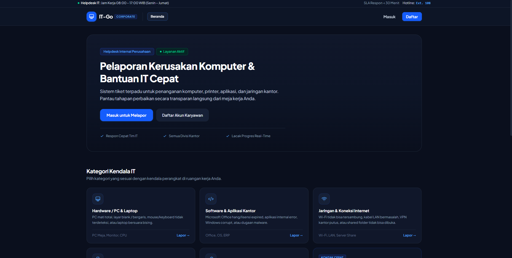
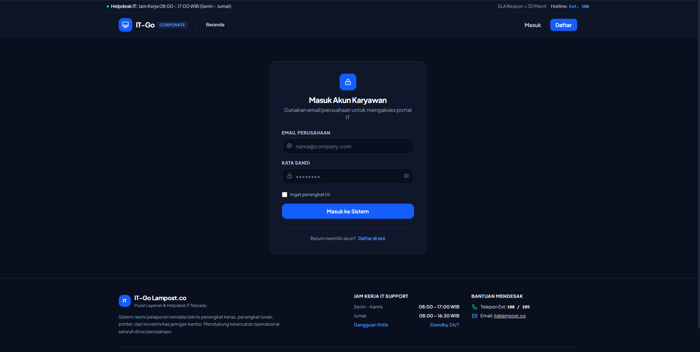
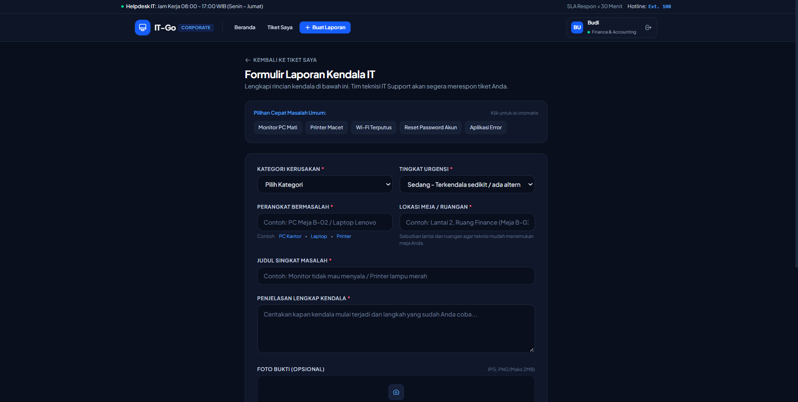
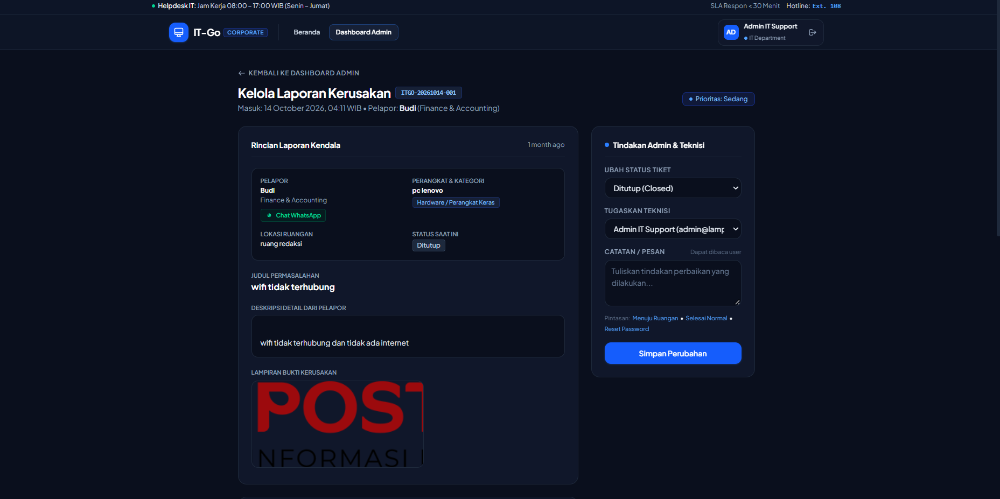
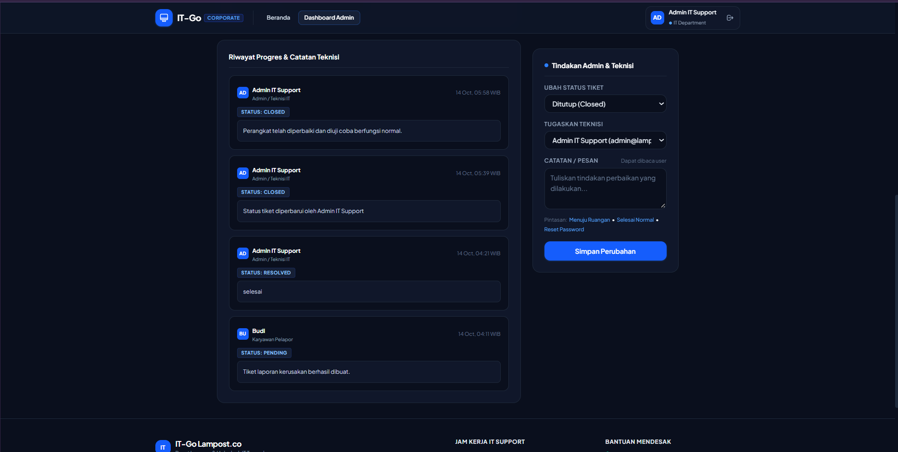
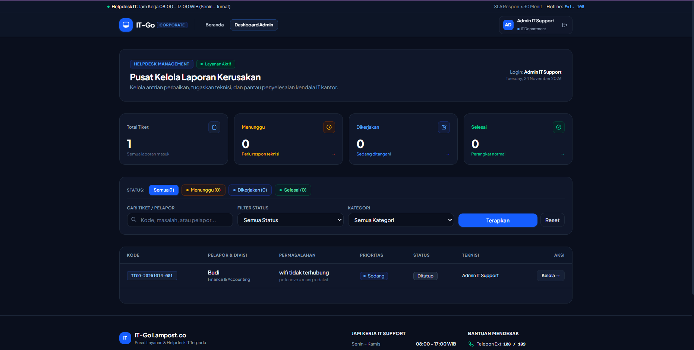

# IT-Go — Sistem Pelaporan & Manajemen Kendala IT

**IT-Go** adalah aplikasi web internal berbasis **Laravel 13** dan **Blade** yang dirancang untuk memudahkan seluruh karyawan **PT Masa Kini Mandiri (Lampung Post)** dalam melaporkan kerusakan perangkat keras, perangkat lunak, maupun gangguan jaringan langsung ke Departemen IT, lengkap dengan pelacakan status penanganan secara *real-time*.

---

## Daftar Isi

- [Tentang Proyek](#tentang-proyek)
- [Pratinjau Antarmuka](#pratinjau-antarmuka)
- [Fitur Utama](#fitur-utama)
- [Teknologi yang Digunakan](#teknologi-yang-digunakan)
- [Instalasi & Konfigurasi Lokal](#instalasi--konfigurasi-lokal)
- [Arsitektur Alur Pemesanan](#arsitektur-alur-pemesanan)
- [Lisensi](#lisensi--kredit)

---

## Pratinjau Aplikasi (Preview)

### 1. Halaman Utama (Landing Page)


### 2. Halaman Autentikasi (Login & Register)


### 3. Formulir Laporan Kerusakan (User)


### 4. Detail & Detail Progres Tiket (User)



### 5. Dashboard Monitoring & Kelola Tiket (Admin IT)


---

## Fitur Utama

### Hak Akses Karyawan (User)
* **Autentikasi Mandiri:** Registrasi akun karyawan dengan pencatatan divisi/departemen dan nomor kontak.
* **Pengajuan Tiket Kerusakan:** Pelaporan terstruktur berdasarkan kategori kerusakan, nama perangkat, lokasi ruangan, tingkat urgensi (*Low, Medium, High, Urgent*), serta unggah foto bukti kerusakan.
* **Penomoran Tiket Otomatis:** Pembuatan kode tiket unik secara berurutan per hari (Format: `ITGO-YYYYMMDD-XXX`).
* **Pelacakan Histori Progres:** Melihat status tiket terkini (*Pending, In Progress, Resolved, Closed*), teknisi yang ditugaskan, serta log catatan perbaikan dari tim IT.

### Hak Akses Departemen IT (Admin)
* **Dashboard Statistik:** Ringkasan jumlah keseluruhan laporan, tiket menunggu (*pending*), sedang diproses (*in progress*), dan selesai (*resolved*).
* **Filter & Pencarian Cepat:** Penyaringan tiket berdasarkan kode tiket, nama pelapor, status penanganan, dan kategori kerusakan.
* **Penugasan & Pembaruan Status:** Menugaskan teknisi IT penanggung jawab, memperbarui status tiket, dan mencatat log tindakan perbaikan.
* **Proteksi Hak Akses:** Dilengkapi middleware khusus (`AdminMiddleware`) untuk membatasi akses panel kontrol hanya bagi akun ber-role `admin`.

---

## Teknologi yang Digunakan

* **Backend Framework:** Laravel 13 (PHP 8.3+)
* **Frontend & Templating:** Blade Engine, Tailwind CSS, Plus Jakarta Sans Typography
* **Database:** MySQL (Laragon Local Environment)
* **Storage:** Laravel Public Disk Symbolic Link (untuk lampiran foto kerusakan)

---

## Panduan Instalasi Lokal

Ikuti langkah-langkah berikut untuk menjalankan proyek ini di lingkungan lokal:

### 1. Clone Repositori
```bash
git clone https://github.com/MadeRaditya/IT-Go-Lampung-Post.git
cd IT-Go-Lampung-Post

```

### 2. Instal Dependensi PHP

```bash
composer install

```

### 3. Konfigurasi Environment

Salin file `.env.example` menjadi `.env`, lalu sesuaikan pengaturan koneksi database MySQL Anda:

```bash
cp .env.example .env

```

Ubah bagian konfigurasi database pada file `.env`:

```env
DB_CONNECTION=mysql
DB_HOST=127.0.0.1
DB_PORT=3306
DB_DATABASE=it_go_db
DB_USERNAME=root
DB_PASSWORD=

```

### 4. Generate Application Key

```bash
php artisan key:generate

```

### 5. Jalankan Migrasi & Seeder Database

Perintah ini akan membuat struktur tabel (`users`, `categories`, `tickets`, `ticket_logs`) sekaligus mengisi data awal kategori kerusakan dan akun bawaan:

```bash
php artisan migrate:fresh --seed

```

### 6. Buat Symbolic Link Storage

Agar file foto bukti kerusakan yang diunggah dapat ditampilkan di browser:

```bash
php artisan storage:link

```

### 7. Jalankan Server Lokal

```bash
npm run build
php artisan serve
```

Akses aplikasi melalui browser di `http://localhost:8000` 

---

## Akun Bawaan (Database Seeder)

Setelah menjalankan perintah `--seed`, Anda dapat langsung menguji aplikasi menggunakan kredensial berikut:

| Peran (Role) | Email | Password |
| --- | --- | --- |
| **Admin IT** | `admin@itgo.com` | `password123` |
| **Karyawan (User)** | `budi@company.com` | `password123` |

---

## Struktur Direktori Penting

```text
├── app/
│   ├── Http/
│   │   ├── Controllers/
│   │   │   ├── AdminDashboardController.php  # Logika dashboard & penanganan tiket Admin
│   │   │   ├── AuthController.php            # Logika login, register, dan logout
│   │   │   └── TicketController.php          # Logika pembuatan & riwayat tiket User
│   │   └── Middleware/
│   │       └── AdminMiddleware.php           # Proteksi rute khusus Admin IT
│   └── Models/
│       ├── Category.php
│       ├── Ticket.php
│       ├── TicketLog.php
│       └── User.php
├── database/
│   ├── migrations/                           # Skema tabel users, categories, tickets, ticket_logs
│   └── seeders/                              # Seeder akun awal & kategori kerusakan
├── public/
│   └── screenshots/                          # Direktori penyimpanan gambar preview README
└── resources/
    └── views/
        ├── admin/                            # Tampilan dashboard & kelola tiket Admin
        ├── auth/                             # Tampilan login & register
        ├── layouts/                          # Master layout, navbar, dan footer
        ├── user/tickets/                     # Tampilan buat laporan & daftar tiket User
        └── welcome.blade.php                 # Halaman utama (Landing Page)

```

---

## Lisensi & Kepemilikan

Dikembangkan oleh **[Made Raditya](https://github.com/MadeRaditya)** untuk kebutuhan operasional internal **PT Masa Kini Mandiri (Lampung Post)**.
